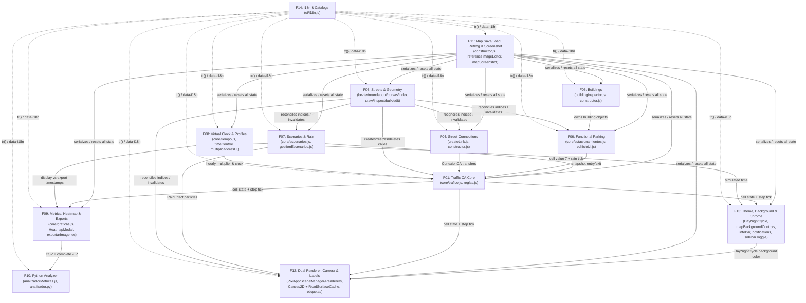

# FLUVI v1 — Comprehensive Feature & Relationship Map

> **Target directory:** `apps/v1/`
> **Audience:** Autonomous coding/research agents and maintainers working on FLUVI v1 (or porting v1 behavior to v2).
> **Companion docs:** Read [`docs/v1/application-map.md`](../docs/v1/application-map.md) first for line-range navigation, [`CONTEXT.md`](../CONTEXT.md) for domain terms, [`docs/v1/localization.md`](../docs/v1/localization.md) for i18n rules, and [`docs/v1/requirements.md`](../docs/v1/requirements.md) for acceptance requirements.
> **Paths:** All relative file paths below are relative to `apps/v1/` unless prefixed with repo-root.

---

## Table of Contents

1. [Domain Glossary (Strict Vocabulary)](#1-domain-glossary-strict-vocabulary)
2. [Runtime Architecture & Global Contracts](#2-runtime-architecture--global-contracts)
   - [2.1 Script Load Order & Classic-Script Boundary](#21-script-load-order--classic-script-boundary)
   - [2.2 Master Simulation Tick Pipeline](#22-master-simulation-tick-pipeline)
   - [2.3 Cross-Feature Dependency Graph](#23-cross-feature-dependency-graph)
   - [2.4 Shared Global State, Custom Events & `localStorage` Registry](#24-shared-global-state-custom-events--localstorage-registry)
   - [2.5 Cross-Feature Coupling & Side-Effect Matrix](#25-cross-feature-coupling--side-effect-matrix)
3. [Exhaustive Feature Catalog (`F01`–`F14`)](#3-exhaustive-feature-catalog-f01f14)
   - [F01: Traffic Simulation Engine & Cellular Automaton Core](#f01-traffic-simulation-engine--cellular-automaton-core)
   - [F02: Built-in Campus Map & Background Zones](#f02-built-in-campus-map--background-zones)
   - [F03: Street Construction, Geometry & Editing](#f03-street-construction-geometry--editing)
   - [F04: Directed Street Connections (`Conexión entre calles`)](#f04-directed-street-connections-conexión-entre-calles)
   - [F05: Buildings (`Edificios`) & Appearance Modes](#f05-buildings-edificios--appearance-modes)
   - [F06: Functional Parking (`Estacionamiento funcional`)](#f06-functional-parking-estacionamiento-funcional)
   - [F07: Scenarios, Disruptions, Random Rain & Instant Flood](#f07-scenarios-disruptions-random-rain--instant-flood)
   - [F08: Virtual Clock & Hourly Traffic Profiles](#f08-virtual-clock--hourly-traffic-profiles)
   - [F09: Traffic Metrics, Live Charts, Heatmaps & Complete Exports](#f09-traffic-metrics-live-charts-heatmaps--complete-exports)
   - [F10: In-Browser Python Metrics Analyzer](#f10-in-browser-python-metrics-analyzer)
   - [F11: Map Persistence, Session Lifecycle, Reference Images & Whole-Map Screenshot](#f11-map-persistence-session-lifecycle-reference-images--whole-map-screenshot)
   - [F12: Dual Rendering Engine, Camera, Minimap & Spatial Interaction](#f12-dual-rendering-engine-camera-minimap--spatial-interaction)
   - [F13: Personalization, Theme & Interface Controls](#f13-personalization-theme--interface-controls)
   - [F14: Internationalization (i18n) & Localization Contract](#f14-internationalization-i18n--localization-contract)
4. [Agent Impact Playbooks (Change → Downstream Checks)](#4-agent-impact-playbooks-change--downstream-checks)
5. [Unloaded / Legacy / Non-Runtime Artifacts](#5-unloaded--legacy--non-runtime-artifacts)

---

## 1. Domain Glossary (Strict Vocabulary)

Use these exact terms from `CONTEXT.md` when reading, modifying, or naming symbols/tests/issues:

| Term | Exact Definition | Avoid |
| --- | --- | --- |
| **Calle (street)** | Positioned stretch of road with lanes and physical cells. `tipo` is one of `generador`, `conexion`, or `devorador`. | — |
| **Conexión entre calles (street connection)** | Directed transfer of vehicles from a lane/cell of one street to a lane/cell of another (`ConexionCA`). Distinct from a street whose `tipo === 'conexion'`. | Calling a link a "connection street" |
| **Transfer mapping** | One directed `(sourceLane, sourceCell) → (destLane, destCell)` pair inside a street connection. | — |
| **Curve control point** | Off-street handle pulling a curved street's shape; not a traffic endpoint. Deleting it reshapes the street without deleting the street. | — |
| **Street centerline** | Path from street start to end around which lanes are offset. Distinct from directed street connections. | — |
| **Etiqueta (map label)** | Street or building name drawn on the map, attached to that object (not a free-standing annotation). | — |
| **Edificio (building)** | Named map object with fixed `appearanceMode` / `geometryType`: rectangular, polygonal, or image-based. | — |
| **Edificio rectangular** | Building with independent width and height (equal sides = square). | Calling all rectangular buildings "square" |
| **Edificio poligonal** | Building whose visible footprint and hit-test follow user-defined polygon vertices. | — |
| **Edificio con imagen** | Building rendering a user-uploaded or bundled image inside a rectangular footprint. | — |
| **Estacionamiento funcional** | Building connected to street cells that receives/releases vehicles. Independent of name or parking-themed artwork. | Inferring parking from image/name |

---

## 2. Runtime Architecture & Global Contracts

FLUVI v1 is a **client-side, single-page static web application** (`index.html`) with **no application bundler and no runtime ES modules**. `scripts/build-static.mjs` validates locale freshness and copies `index.html`, `src/`, and `assets/` verbatim into `dist/` for Cloudflare `Website.StaticSite` deployment (`infra/alchemy.run.ts`). Vite (`pnpm --filter v1 dev`) is only a local dev server.

### 2.1 Script Load Order & Classic-Script Boundary

All runtime scripts in `index.html` are **classic browser scripts** sharing top-level lexical bindings (`const`/`let`/`function`) and `window.*` globals. Moving a script tag or adding `type="module"` breaks runtime contracts.

```text
<head> (synchronous before body paint & app scripts)
  1. ./src/libs/chart.js/chart.umd.min.js       (Chart.js 4.4.0 UMD)
  2. CDN: pyodide v0.25.0                       (window.loadPyodide)
  3. CDN: jszip 3.10.1                          (window.JSZip)
  4. src/js/ui/darkMode.js                      (restore theme before first paint)
  5. src/libs/i18next/i18next.min.js            (i18next 26.5.3)
  6. src/locales/catalogs.js                    (generated ES/EN catalogs)
  7. src/js/ui/i18n.js                          (sets <html lang>, window.fluviI18n, window.tr)

<body> (ordered classic runtime scripts, index.html:2610-2698)
  8. ui/loadingSystem.js                        (calls tr() at eval time)
  9. CDN: pixi.js@7                             (window.PIXI)
 10. renderer/utils/{CoordinateConverter,AssetLoader}.js
 11. renderer/{DayNightCycle,CameraController,RainEffect,SceneManager,PixiApp}.js
 12. renderer/renderers/{BackgroundArea,ReferenceImage,Calle,Carro,Edificio,Conexion,UI,EditorHandles,Minimap}Renderer.js
 13. ui/{notifications,streetListUI,HeatmapModal}.js
 14. core/{bezierStreet,roundaboutStreet,curvas,cellGeometryIndex}.js
 15. ui/etiquetas.js
 16. core/{ClickActionManager,escenarios}.js → ui/gestionEscenarios.js
 17. core/{tiempo,estacionamientos}.js
 18. renderer/CanvasRoadSurfaceCache.js
 19. core/reglas.js                             (lexical `reglas` table; NOT on window)
 20. core/trafico.js                            (main simulation state, Canvas 2D renderer, Pixi bridge, input)
 21. core/graficas.js → ui/{exportarImagenesMetricas,mapScreenshot}.js
 22. ui/{editor,edificioUI,mapBackgroundControls,constructor}.js
 23. ui/{drawStreet,drawRoundabout,buildingInspector,streetInspector,bulkStreetEditor,editStreetGeometry,createLink,referenceImageEditor}.js
 24. ./src/bootstrap-5.0.2-dist/js/bootstrap.bundle.min.js
 25. ui/{tooltips,modalFixes,multiplicadoresUI,consoleControl,cellDetectionControl,sidebarToggle,infoBar,timeControl,analizadorMetricas}.js
```

### 2.2 Master Simulation Tick Pipeline

Every simulation step (`paso()` nested inside `iniciarSimulacion` in `core/trafico.js`) executes in this **strict order**. Preserve this sequence when modifying any traffic, parking, rain, clock, or metrics feature:

```mermaid
flowchart LR
    T1["1. Vehicle Generation\n(generarCelulas)\nF01 + F08 multiplier"] --> T2["2. Connection Transfers\n(ConexionCA.transferir)\nF01 + F04"]
    T2 --> T3["3. Lane Changes\n(cambioCarril)\nF01"]
    T3 --> T4["4. Street Update\n(Parking snapshot → CA rules)\nF01 + F06"]
    T4 --> T5["5. Random Rain\n(aplicarLluviaAleatoria)\nF07"]
    T5 --> T6["6. Virtual Clock\n(avanzarTiempo)\nF08"]
    T6 --> T7["7. Metrics Update\n(updateMetrics)\nF09"]
    T7 --> T8["8. Render Frame\n(Pixi incremental or Canvas)\nF12"]
    T8 --> T9["9. Info Bar & FPS\n(recordSimulationFrame)\nF01 + F13"]
```



- **Pause / Manual Step semantics:** `animate()` runs via `requestAnimationFrame`. Pausing halts automatic ticks and clears the FPS sample window (`resetSimulationFPS`). A manual step executes `paso()` **once** (including random rain, virtual clock advance, and `updateMetrics`).
- **Canvas camera coalescing:** Camera pan/zoom commits immediately and schedules a live redraw capped at 30 FPS when paused; if a simulation tick runs in the same frame, it consumes the pending camera redraw without double-painting.

### 2.3 Cross-Feature Dependency Graph



### 2.4 Shared Global State, Custom Events & `localStorage` Registry

#### Core Shared `window.*` State & APIs

| Global | Owner | Primary Consumers | Notes |
| --- | --- | --- | --- |
| `window.calles` | `core/trafico.js` | Every feature | Array of `Calle` objects. Indexes are physical topology IDs (UI sorts via `streetListUI.sortedEntries` without mutating order). |
| `window.conexiones` | `core/trafico.js` | `createLink`, `constructor`, `editor`, `ConexionRenderer` | Array of live `ConexionCA` instances. |
| `window.edificios` | `core/trafico.js` | `buildingInspector`, `constructor`, `estacionamientos`, `EdificioRenderer`, `mapScreenshot` | Array of `Edificio` objects. |
| `window.backgroundAreas` | `core/trafico.js` | `BackgroundAreaRenderer`, `constructor`, `trafico` | Array of campus background zones. |
| `window.referenceImage` | `ui/constructor.js` | `referenceImageEditor`, `ReferenceImageRenderer`, `trafico`, `mapScreenshot` | Local or linked reference image state + alignment. |
| `window.escala`, `offsetX`, `offsetY` | `core/trafico.js` / `CameraController.js` | All DOM overlays (`editStreetGeometry`, `buildingInspector`, `bulkStreetEditor`, `referenceImageEditor`, `createLink`), `etiquetas` | Camera mirror; `CameraController` is authoritative when `USE_PIXI` is active. |
| `window.USE_PIXI`, `window.pixiApp` | `core/trafico.js` / `PixiApp.js` | Renderers, tools, `mapScreenshot`, `exportarImagenesMetricas`, `escenarios` | Active renderer flag & singleton (`sceneManager`, `cameraController`, `rainEffect`). |
| `window.isPaused`, `window.streetEditPause` | `core/trafico.js` | All editing/drawing tools, `infoBar`, `escenarios` | Structural edits pause via `streetEditPause()`; explicit Resume finishes focused edits. |
| `window.calleSeleccionada`, `window.edificioSeleccionado` | `core/trafico.js` / `editor.js` | Inspectors, `bulkStreetEditor`, `constructor`, renderers | Current single-object selection. |
| `window.cellGeometryIndex` | `core/cellGeometryIndex.js` | `trafico`, `editStreetGeometry`, `CalleRenderer`, `createLink` | Spatial index (`findNearest`, `nearbyStreets`, `invalidate`, `clear`). |
| `window.canvasRoadSurface` | `core/trafico.js` + `CanvasRoadSurfaceCache.js` | `trafico`, `constructor` | `{ cache: { draw, invalidate, clear, bytes }, drawSurface, drawStreets }`. |
| `window.estadoEscenarios` | `core/escenarios.js` | `trafico`, `CalleRenderer`, `CarroRenderer`, `gestionEscenarios`, `constructor` | Active paint modes, blocked cells map, rain state. |
| `window.configuracionTiempo` | `core/tiempo.js` | `trafico`, `timeControl`, `multiplicadoresUI`, `DayNightCycle`, `graficas`, `constructor` | Virtual clock & 7×24 hourly multipliers. |
| `window.mapBackgroundCycle` | `renderer/DayNightCycle.js` | `mapBackgroundControls`, `SceneManager`, `trafico`, `mapScreenshot`, `constructor` | Shared sky/preset/custom background color model. |
| `window.labelVisibility`, `window.labelFontSize` | `core/trafico.js` | `etiquetas.js`, `UIRenderer`, `EdificioRenderer`, `SceneManager` | Session-only (`'off'` / `'streets'` / `'buildings'` / `'both'`, default `14` px). Never persisted. |
| `window.fluviI18n`, `window.tr`, `window.fluviNotify` | `ui/i18n.js`, `ui/notifications.js` | Entire UI & renderer text paths | Translation & text-safe severity toast APIs. |

#### Custom DOM Events

| Event Name | Target | Dispatched By | Listeners | Payload |
| --- | --- | --- | --- | --- |
| `street-drawn` | `document` | `ui/drawStreet.js`, `ui/drawRoundabout.js` | `ui/streetInspector.js` | `{ detail: { calle } }` |
| `street-deleted` | `document` | `ui/constructor.js` | `ui/streetInspector.js` | `{ detail: { calle } }` |
| `street-lane-directions-changed` | `document` | `ui/streetInspector.js`, `ui/bulkStreetEditor.js`, `ui/editor.js` | `ui/constructor.js` (refreshes saved-link compatibility warnings) | `{ detail: { calle } }` |
| `building-selected` | `document` | `ui/buildingInspector.js` | `ui/buildingInspector.js` | `{ detail: { building } }` |
| `clickActionRegistered` | `window` | `core/ClickActionManager.js` | Extensible listeners | `{ detail: { id, action } }` |
| `clickActionChanged` | `window` | `core/ClickActionManager.js` | Extensible listeners | `{ detail: { actionId } }` |

#### `localStorage` Keys

| Key | Owner | Values / Format | Persistence Scope |
| --- | --- | --- | --- |
| `fluvi.interfaceLanguage` | `ui/i18n.js` | `'es'` \| `'en'` | Next startup only (never mutates active session). |
| `modoOscuro` | `ui/darkMode.js`, `core/trafico.js` | `'true'` \| `'false'` | Restored before first paint. |
| `usePixi` | `core/trafico.js` | `'true'` \| `'false'` | Overrides desktop-Pixi / mobile-Canvas default. |
| `sidebarVisible` | `ui/sidebarToggle.js` | `'true'` \| `'false'` | Sidebar open/collapsed state. |
| `configCollapsed` | `core/trafico.js` | `'true'` \| `'false'` | Street config panel collapse state. |
| `cellDetectionEnabled` | `ui/cellDetectionControl.js` | `'true'` \| `'false'` | Click-cell detection toggle. |
| `consoleLogsEnabled` | `ui/consoleControl.js` | `'true'` \| `'false'` | Console log suppression toggle (off by default). |
| `escenariosGuardados` | `core/escenarios.js` | JSON array of saved scenario objects | Browser-local scenario library. |

### 2.5 Cross-Feature Coupling & Side-Effect Matrix

When an action occurs in **Trigger**, these **Downstream Features** MUST stay synchronized:

| Trigger Action | Downstream Side Effects & Invariants |
| --- | --- |
| **Resize street (`tamano` / `carriles`)** | `editor.js:aplicarNuevasDimensiones` → preserves `laneDirections` & `laneGenerationEnabled` (new lanes default `+1`, enabled); remaps roundabout indexed state by angle; reconciles/prunes out-of-range `conexiones`, parking pairs (`estacionamientos`), and scenario marks (`escenarios`); invalidates `cellGeometryIndex` & `canvasRoadSurface.cache`; refreshes Pixi/Canvas. |
| **Change lane direction (`laneDirections`)** | Physical cell indices & vehicles do NOT move. Dispatches `street-lane-directions-changed` → `constructor.js` flags incompatible saved links in the list; `CalleRenderer`/`CarroRenderer`/Canvas flip arrows & vehicle facing; `graficas.js` flips forward-neighbor lookup; `createLink.js` uses directional endpoints for new drafts. |
| **Delete street (`eliminarObjetoSeleccionado` / `Supr`)** | Removes street from `window.calles`; removes dependent `conexiones`; cleans up building parking pairs pointing to it; removes scenario marks; invalidates `cellGeometryIndex` & `canvasRoadSurface.cache.invalidate(calle)`; dispatches `street-deleted`; refreshes selectors, metrics street set, and both renderers. |
| **Delete building (confirmed)** | Calls `limpiarConexionesEdificio` (releases owned street parking endpoints & clears occupancy); removes from `window.edificios`; hides `buildingInspector`; refreshes selectors and both renderers (clears hover tooltip to prevent leaks). |
| **New Map / Load Map (`limpiarSimulacionActual`)** | Pauses simulation; deactivates all drawing/link/bulk/inspector tools (`bulkStreetEditor.clear()`, `buildingInspector.deactivate()`, `createLinkTool.cancel()`); clears `calles`, `conexiones`, `edificios`, `backgroundAreas`, `referenceImage`; resets `estacionamientos`, `escenarios` (turns rain off, resets instant flood %), `graficas`, `infoBar`, `cellGeometryIndex.clear()`, `canvasRoadSurface.cache.clear()`, `mapBackgroundCycle` (defaults to `sky`), Pixi `SceneManager.clearAll()` (preserving `AssetLoader` textures). **Load Map** increments replacement token (guarding async image decodes & deferred links), restores roads → links → buildings/parking → scenarios → personalization, and restores saved virtual clock **after** `infoBar` reset. **Preserves** session-only `labelVisibility` & `labelFontSize`. |
| **Apply Scenario Time (`timeControl.js`)** | Calls `window.resetScenarioTraffic()` before setting clock: clears vehicles, waiting/blocked-link flags, parking occupancy, metrics, and generation counter — **preserving** map geometry, blockers/floods, generation settings, and pause state. Refreshes clock labels without counting a tick. |
| **Start Tool / Mode (Draw / Link / Paint / Bulk)** | Mutual exclusion: Shift-drag in `bulkStreetEditor` cancels `drawStreetTool`, `drawRoundaboutTool`, `drawBuildingTool`, `createLinkTool`, focused inspector edits, and single selection. Pixi `CameraController` pan yields to active drawing tools on pointer down. Entering scenario paint mode exits `editorVisual` edit mode. |
| **Switch Interface Language** | Saves `fluvi.interfaceLanguage` only; shows notice in active language. Does **not** reload, pause, mutate simulation, or rename stored street/building/scenario data. |

---

## 3. Exhaustive Feature Catalog (`F01`–`F14`)

---

### F01: Traffic Simulation Engine & Cellular Automaton Core

**Summary:** Discrete 1D-per-lane cellular automaton traffic model with 6 vehicle types, stationary obstructions, mixed-direction lanes, inter-street transfers, parking integration, and runtime transport controls.

#### Sub-features & Exact Details
- **F01.1 CA Rule Table & Cell Values:** Cell values are `0` (empty), `1–6` (six distinct vehicle sprites), `7` (stationary obstruction: lane block, flood, or obstacle). Rule lookup table `reglas` lives in `core/reglas.js` (classic lexical binding, **not** on `window`). Missing-rule fallback stays in `core/trafico.js`.
- **F01.2 Street Model & Types (`TIPOS`):** `crearCalle` creates per-lane cell arrays (`carriles × tamano`), `tipo` (`generador` | `conexion` | `devorador`), `probabilidadGeneracion`, `probabilidadCambioCarril`, `laneDirections` (`+1` forward, `-1` reverse; missing defaults `+1`), and `laneGenerationEnabled` (only explicit `false` disables spawning). Physical cell indices are always `0 .. tamano - 1` regardless of direction.
- **F01.3 Vehicle Generation & Per-Lane Switches:** `generarCelulas` spawns vehicles on `generador` streets at each lane's directional entry cell (`getLaneEntryCell`: `0` for `+1`, `tamano - 1` for `-1`) if empty and `laneGenerationEnabled[lane] !== false`. Effective probability = `(globalOverride ?? streetProb) * hourlyMultiplier`.
- **F01.4 Session-Only Global Generation Override:** `#toggleGeneracionGlobal` + `#inputGeneracionGlobal` in Configuración de Calles (`generacionGlobal`, `inicializarGeneracionGlobal`). Overrides individual generator street probabilities for the session without overwriting stored street probabilities; applies **before** hourly multipliers; respects per-lane `laneGenerationEnabled === false`. Distinct from toolbar random-fill.
- **F01.5 Ordinary Street Update & Parking Snapshot:** `actualizarCalle` resolves functional parking entries/exits **before** CA movement using per-lane consumed-source / spawned-destination tracking so downstream occupancy remains snapshot-based (no vehicle duplication or loss). Devourer (`devorador`) exits consume only vehicle values `1–6` at the lane's directional exit cell (`getLaneExitCell`); obstruction `7` never leaves.
- **F01.6 Periodic Roundabout Update:** Wraps cell neighborhood modulo `tamano` in each lane's `laneDirections` (`+1` clockwise, `-1` counterclockwise).
- **F01.7 Lane Changes (`cambioCarril`):** Vehicles may change only between adjacent lanes sharing the **same** travel direction, respecting collision/waiting rules and `probabilidadCambioCarril`.
- **F01.8 Inter-Road Transfers (`ConexionCA`):** `ConexionCA.transferir` transfers only vehicle values `1–6` (never `7`) across `lineal`, `incorporacion`, or `probabilistica` links, respecting waiting cells.
- **F01.9 Transport Controls (Play/Pause, Step, Speed, Clear, Random Fill):**
  - Play/Pause (`isPaused`), `streetEditPause()` for structural edits (explicit Resume finishes focused edits/gestures).
  - Manual Step: executes one full `paso()` while paused (advances clock, rain, metrics).
  - Speed slider: adjusts step interval.
  - Clear Vehicles: removes `1–6`, preserves `7` obstructions.
  - Random Fill + Fill Probability slider: populates empty cells with `1–6` without overwriting `7` obstructions.
- **F01.10 Direct Cell Vehicle Editing:** Clicking a road cell toggles/adds/removes a vehicle (`ClickActionManager` in Pixi; mouse handler in Canvas 2D). While paused, Canvas renders immediately and Pixi updates via `CarroRenderer.updateCell`; while running, Canvas defers to the next tick redraw (no extra full-scene draw).
- **F01.11 Info Ribbon & Completed-Step FPS (`ui/infoBar.js`):** Displays generation count, cached vehicle population, virtual clock, traffic status, and measured simulation FPS (`recordSimulationFrame` per completed tick; `resetSimulationFPS` on pause/reset).

#### Files, Globals & Tests
- **Files:** `core/reglas.js`, `core/trafico.js`, `core/ClickActionManager.js`, `ui/infoBar.js`.
- **DOM IDs:** `#toggleGeneracionGlobal`, `#inputGeneracionGlobal`, `#selectCalle`, transport buttons/sliders, info bar (`index.html:2227-2262`).
- **Globals:** `calles`, `conexiones`, `TIPOS`, `TIPOS_CONEXION`, `crearCalle`, `getLaneDirection`, `getLaneEntryCell`, `getLaneExitCell`, `effectiveSourceCell`, `isConnectionDirectionCompatible`, `isPaused`, `streetEditPause`, `resetScenarioTraffic`, `clickActionManager`, `recordSimulationFrame`, `resetSimulationFPS`, `resetSimulationInfo`.
- **Relationships:** Consumes `F04` (`ConexionCA`), `F06` (`estacionamientos`), `F07` (`aplicarLluviaAleatoria`, `7` cells), `F08` (`avanzarTiempo`, hourly multiplier). Feeds `F09` (`updateMetrics`), `F12` (renderers), `F13` (`infoBar`).
- **Tests:** `reglas.spec.mjs`, `global-generation.spec.mjs`, `lane-generation.spec.mjs`, `lane-directions.spec.mjs`, `parking-conservation.spec.mjs`, `info-bar-fps.spec.mjs`, `tests/baseline/baseline.spec.mjs`, `tests/smoke/{car-click,bezier-car-click,car-click-performance}.mjs`.

---

### F02: Built-in Campus Map & Background Zones

**Summary:** Pre-populated IPN/Zacatenco campus street network, buildings, hard-coded directed connections, and decorative background areas loaded on startup.

#### Sub-features & Exact Details
- **F02.1 Built-in Topology:** Constructed in `core/trafico.js:iniciarSimulacion` — 85 streets (mix of straight and legacy curved roads), bundled campus buildings with `assets/images/buildings/*.png`, and hard-coded `ConexionCA` mappings. Prebuilds `cellGeometryIndex` after construction.
- **F02.2 Background Zones (`window.backgroundAreas`):** Rectangular/polygonal campus ground zones (parks, fields, lots) with colors/labels. Drawn by `BackgroundAreaRenderer.js` (Pixi offline-canvas cached textures) and `trafico.js` (Canvas). Persisted in map JSON and cleared on New Map; no standalone zone-drawing UI tool exists in v1.
- **F02.3 Deterministic Baseline Fixture:** `tests/baseline/baseline.json` records seeded topology/traffic invariants; regenerated only explicitly via `pnpm --filter v1 test:baseline:record`.

#### Files, Globals & Tests
- **Files:** `core/trafico.js`, `renderer/renderers/BackgroundAreaRenderer.js`, `ui/constructor.js` (save/load/clear), `assets/images/buildings/*`.
- **Relationships:** Initial input to `F01`, `F11`, `F12`. Verified for language-independence by `F14` (`language-invariance.spec.mjs`).
- **Tests:** `simulation-zones.spec.mjs`, `tests/baseline/baseline.spec.mjs`.

---

### F03: Street Construction, Geometry & Editing

**Summary:** Complete suite for creating, reshaping, inspecting, bulk-editing, and deleting straight, diagonal, legacy-curved, multi-section Bézier, and circular roundabout streets.

#### Sub-features & Exact Details
- **F03.1 Map-First Straight/Diagonal Drawing (`ui/drawStreet.js`):** Click-drag from empty map space with quantized world-space cell preview; creates street via `crearCalle`, refreshes selectors, selects it, and dispatches `street-drawn`. Escape cancels. Exposes `window.drawStreetTool`.
- **F03.2 Map-First Roundabout Drawing (`ui/drawRoundabout.js` + `core/roundaboutStreet.js`):** Center-to-inner-radius drag gesture with live preview and validation. Model: `geometryType: 'roundabout'`, center `x`/`y`, `innerRadius`, `startAngle`, derived clockwise physical sector count, per-lane `laneDirections` (`+1` CW / `-1` CCW). Exposes `window.roundaboutStreet` and `window.drawRoundaboutTool`.
- **F03.3 Legacy New-Street Modal (`ui/constructor.js`):** `#modalNuevaCalle` form with validation and `agregarCalle`. Coexists with map-first drawing.
- **F03.4 Immediate Street Inspector (`ui/streetInspector.js`):** Floating inspector for selected street: exact name, X/Y, angle, length (quantized cells), lanes (1–10), `tipo`, generation & lane-change probabilities, per-lane direction (`+1`/`-1`) and generator enable/disable checkboxes ("Generar vehículos"), roundabout read-only cell count / radius, and Bézier conversion/controls/anchors/curve-strength adjustment. Exposes `window.streetInspector` including `geometryErrorMessage(reason, fallbackKey)` reused by map gestures.
- **F03.5 Multi-Section Bézier Curves (`core/bezierStreet.js`):** `window.streetBezier` provides world-space point evaluation, arc-length cell/lane placement, exact section splitting, rounded non-collinear seams (without moving stored anchor coordinates), geometry caching, and overlap validation. Streets store `bezierGeometry`, `bezierControls`, `endX`/`endY`, optional `bezierSegments`, and `vertices: []` (must still take curved-cell path for hit-testing; straight footprint is non-interactive). Inspector also supports perpendicular **curve-strength** scaling with atomic validation.
- **F03.6 Legacy Vertex Curves (`core/curvas.js`):** Vertex initialization, cached coordinate prefixes, tangent angle lookup, vertex dragging, and `Z`-key vertex-edit mode toggle (visual badge in `ui/infoBar.js`). Dispatches Bézier and roundabout cell lookups to `streetBezier` / `roundaboutStreet`.
- **F03.7 Direct Map Geometry Handles (`ui/editStreetGeometry.js`):** Renderer-neutral DOM handles for straight endpoints, Bézier anchors/controls, roundabout center move & radial resize, and body drag. Uses `cellGeometryIndex` for Bézier body hit-testing. Validates before committing; pauses via `streetEditPause`.
- **F03.8 Legacy Visual Editor & Dimension Reconciliation (`ui/editor.js`):** `EditorCalles` (`window.editorCalles`) provides enter/save/cancel edit sessions (original-state restoration, not general undo/redo), move/rotate handles (paired with `renderer/renderers/EditorHandles.js`), and **`aplicarNuevasDimensiones(calle, newCells, newLanes)`** — the central reconciler that resizes cell arrays, preserves `laneDirections`/`laneGenerationEnabled`, remaps roundabout indices by angle, and prunes/reconciles dependent connections, parking pairs, and scenario marks.
- **F03.9 Shift-Drag Bulk Street Editor (`ui/bulkStreetEditor.js`):** Window-capture Shift + left-drag rectangle selects all streets whose cell footprints are **fully enclosed**. Floating `#bulkStreetInspector` allows editing **only** lane count (`#bulkStreetLanes`, 1–10) and per-lane directions (`#bulkStreetDirections`) across all selected streets. Validates all candidates atomically before mutating; delegates lane-count changes to `editorCalles.aplicarNuevasDimensiones`; dispatches `street-lane-directions-changed`. Exposes `window.bulkStreetEditor` (`clear()`, `getSelected()`). Escape or close clears selection.
- **F03.10 Deletion (`Supr`/`Delete` & Inspector):** `Supr`/`Delete` deletes the selected street immediately without confirmation — **unless** a Bézier anchor/control point is selected, which takes priority and removes only that point. Shared cleanup runs in `constructor.js:eliminarObjetoSeleccionado`.
- **F03.11 Spatial Cell Index (`core/cellGeometryIndex.js`):** Caches cell centers per street with geometry-signature invalidation; `findNearest(x, y, calles)` preserves scan tie-order; `nearbyStreets(x, y, calles)` supports topmost hit-testing; `invalidate(calle?)` and `clear()`.
- **F03.12 Alphabetical Street Lists (`ui/streetListUI.js`):** `window.streetListUI.sortedEntries` sorts streets alphabetically for UI dropdowns/checklists without altering `window.calles` indices.

#### Files, Globals & Tests
- **Files:** `core/{bezierStreet,roundaboutStreet,curvas,cellGeometryIndex}.js`, `ui/{drawStreet,drawRoundabout,streetInspector,editStreetGeometry,bulkStreetEditor,editor,streetListUI,constructor}.js`, `renderer/renderers/{CalleRenderer,EditorHandles}.js`.
- **DOM IDs:** `#drawStreetButton`, `#drawRoundaboutButton`, `#modalNuevaCalle`, `#bulkStreetInspector`, `#bulkStreetLanes`, `#bulkStreetDirections`, `#streetSelectionRectangle`, `#selectCalle`, `#selectCalleEditor`.
- **i18n Owners:** `streetDrawing.*`, `streetInspector.*`, `streetEditor.*`, `streetSettings.*`, `streetGeometry.*`, `bulkStreetEditor.*`, `streetTooltip.cell`.
- **Relationships:** Mutates `F01` (`calles`), triggers reconciliation in `F04` (links), `F06` (parking), `F07` (scenarios), invalidates `F12` (`cellGeometryIndex`, `canvasRoadSurface.cache`, Pixi/Canvas).
- **Tests:** `bezier-street.spec.js`, `roundabout-{street,rendering,ui}.spec.mjs`, `bulk-street-editor.spec.mjs`, `editor-simulation-integrity.spec.mjs`, `geometry-index.spec.mjs`, `street-lists.spec.mjs`, `street-localization.spec.mjs`, `tests/smoke/{draw-street,diagonal-street,street-edit,street-handles,curve-street,roundabout,lane-direction-ui}.mjs`.

---

### F04: Directed Street Connections (`Conexión entre calles`)

**Summary:** Directed vehicle transfer links between lanes/cells of two streets, supporting three transfer types, map-first drafting, saved-link editing, and legacy dialogs.

#### Sub-features & Exact Details
- **F04.1 Three Connection Types (`TIPOS_CONEXION`):**
  1. **`lineal`:** Direct 1-to-1 lane transfer from source exit to destination entry.
  2. **`incorporacion`:** Merge transfer with per-lane editable rows and a **Conectar este carril** checkbox (disabled rows stay in draft only and are excluded from preview/validation/commit; ≥ 1 active row required).
  3. **`probabilistica`:** Weighted probabilistic distribution from one source lane/cell to multiple destination exits (validates probability sums).
- **F04.2 Map-First Draft Tool (`ui/createLink.js`):** Anchored at map top-left (`#linkDraftPanel`, `src/css/create-link.css`). Supports clicking source/destination streets on Canvas or Pixi via shared hit-test, type-specific row review, live map preview, and Save/Cancel. Draft stays isolated from live `window.conexiones` until Save.
- **F04.3 Direction Compatibility & Physical Indexing:** `posOrigen = -1` always means the **last physical cell**, not automatically the directional exit. `isConnectionDirectionCompatible` and `effectiveSourceCell` validate transfers; new drafts default to directional exit → directional entry. Duplicate/invalid mappings are rejected with `streetConnection.errors.*`.
- **F04.4 Saved-Link List, Search & Reopen Editing:** `ui/constructor.js` renders a searchable saved-connection list with incompatible-direction warnings (updated on `street-lane-directions-changed`), delete actions, and Edit reopening a saved mapping in `window.createLinkTool.edit(link)`.
- **F04.5 Legacy Connection Modals:** `#modalNuevaConexion` and `#modalEditarConexion` remain in `index.html` and `ui/constructor.js`.
- **F04.6 Visibility & Arrow Rendering:** Toolbar toggle shows/hides connection overlays in both `ConexionRenderer.js` (Pixi) and `trafico.js` (Canvas).

#### Files, Globals & Tests
- **Files:** `ui/createLink.js`, `ui/constructor.js`, `core/trafico.js` (`ConexionCA`, factories), `renderer/renderers/ConexionRenderer.js`, `src/css/create-link.css`.
- **DOM IDs:** `#createLinkButton`, `#linkDraftPanel`, `#modalNuevaConexion`, `#modalEditarConexion`.
- **Globals:** `window.conexiones`, `window.createLinkTool` (`edit`, `cancel`), `window.toggleListaConexiones`, `window.actualizarListaConexiones`, `window.editarConexion`, `window.eliminarConexion`.
- **i18n Owners:** `streetConnection.*`, `notifications.streetConnection.*`.
- **Relationships:** Depends on `F03` (street geometry/directions), drives transfers in `F01`, reconciled/pruned on street resize/delete (`F03`), persisted in `F11`.
- **Tests:** `connection-localization.spec.mjs`, `tests/smoke/{create-link,connection-types,mixed-direction-link-draft,roundabout-link-draft,link-position}.mjs`.

---

### F05: Buildings (`Edificios`) & Appearance Modes

**Summary:** Named map structures with three distinct appearance modes (rectangular, polygonal, image-based), unified immediate inspection, renderer-neutral transformation handles, and portable embedded artwork.

#### Sub-features & Exact Details
- **F05.1 Rectangular Buildings:** Corner-to-corner map drag via `#drawBuildingButton` (`window.drawBuildingTool`), with optional `#buildingProportionLock` square constraint.
- **F05.2 Polygonal Buildings:** Multi-vertex placement via `#drawPolygonBuildingButton` (close polygon or Finish). Exact polygon geometry validation, bounds, and point-in-polygon hit-testing live in `core/trafico.js` (`edificioPolygonGeometry`). Individual vertices are draggable via map handles; invalid gestures preserve prior valid geometry and show a translated reason.
- **F05.3 Uploaded-Image Buildings & Artwork Replacement:** `#uploadBuildingImageButton` / `#buildingImageInput` validates PNG/JPEG/WebP ≤ 5 MB via shared `window.buildingImageCodec` (`constructor.js`), then places on center click (Escape cancels). Stores `appearanceMode: 'uploaded-image'` with embedded `imageData` (portable JSON) and transient decoded `imageElement`. Initial max dimension = 120 world units; always resizes proportionally (palette & square lock hidden). Replacement (`#buildingInspectorReplaceImage`) validates before mutation, resets dimensions to new artwork's aspect ratio, and keeps center/rotation/selection. Pending async uploads/replacements are invalidated on `deactivate()` / map replacement.
- **F05.4 Legacy Bundled Artwork & Rotation Convention:** Bundled campus buildings (`assets/images/buildings/*.png`) use `window.buildingImageAppearance` (`isImage`, `bundledKey`, `preserveBundledIdentity` in `trafico.js`). Renaming preserves `imagen` and `canvasImageKey`. Replacing legacy bundled artwork persists `imageRotationConvention: 'legacy'` (Canvas positive angle, Pixi & handles negative angle), whereas ordinary uploaded images use positive angles in both renderers.
- **F05.5 Immediate Building Inspector & Fixed Color Palette (`ui/buildingInspector.js`):** Immediate name, geometry, rotation, and 6-swatch fixed color palette (pre-existing custom colors outside the 6 swatches remain unselected and preserved). Renderer-neutral DOM move/resize/rotate/vertex handles work identically over Canvas and Pixi.
- **F05.6 Hover Tooltips, Legacy Modal & Confirmed Deletion:** Both Canvas (`canvas.title`) and Pixi (`EdificioRenderer`) show the building's stored label unchanged on hover (tooltip cleaned up on removal). Legacy modal `#modalNuevoEdificio` remains in `constructor.js`. Deletion requires confirmation and invokes `constructor.js:eliminarObjetoSeleccionado`.

#### Files, Globals & Tests
- **Files:** `ui/buildingInspector.js`, `ui/constructor.js`, `core/trafico.js`, `renderer/renderers/EdificioRenderer.js`.
- **DOM IDs:** `#drawBuildingButton`, `#buildingProportionLock`, `#drawPolygonBuildingButton`, `#uploadBuildingImageButton`, `#buildingImageInput`, `#buildingImageStatus`, `#buildingImageCancel`, `#buildingInspectorReplaceImage`, `#buildingInspectorImageInput`, `#modalNuevoEdificio`.
- **Globals:** `window.edificios`, `window.drawBuildingTool`, `window.buildingInspector`, `window.buildingImageCodec`, `window.buildingImageAppearance`, `window.agregarEdificio`.
- **i18n Owners:** `buildingDrawing.*`, `buildingInspector.*`, `buildingEditor.*`, `notifications.building*`.
- **Relationships:** Hosts `F06` (functional parking), rendered by `F12` (`EdificioRenderer` / Canvas + `etiquetas.js`), persisted & bounds-checked in `F11` (`constructor.js`, `mapScreenshot.js`).
- **Tests:** `building-creation.spec.mjs`, `polygonal-building-{geometry,inspector,persistence}.spec.mjs`, `uploaded-building-persistence.spec.mjs`, `tests/smoke/rectangular-building.mjs`.

---

### F06: Functional Parking (`Estacionamiento funcional`)

**Summary:** Optional behavioral layer attached to any building (independent of appearance/name) that absorbs and spawns vehicles on paired street cells while conserving vehicle counts.

#### Sub-features & Exact Details
- **F06.1 Atomic Validation & Endpoint Ownership (`core/estacionamientos.js`):** `validarConfiguracionEstacionamiento(edificio, conexiones, capacidad)` validates complete entrance/exit pairs, positive capacity, in-bounds street/lane/cell indices, no duplicate endpoints, and exclusive endpoint ownership across buildings (returns actionable translated error or `null`). `configurarEstacionamiento` validates all pairs before atomically replacing owned street cell mappings (`CELDA_ENTRADA_ESTACIONAMIENTO` / `CELDA_SALIDA_ESTACIONAMIENTO`).
- **F06.2 Snapshot-Safe Vehicle Conservation (`core/trafico.js`):** During street updates, `procesarEntradaVehiculo` and `intentarGenerarSalida` run before CA rules with per-lane consumed-source and spawned-destination tracking, preventing duplicate transfers, lost vehicles, or exceeding `capacidad`.
- **F06.3 Hourly Entry/Exit Probabilities:** Configurable 24-hour entry/exit probability curves and presets (`configurarHorasPico`, `edificioUI.js`).
- **F06.4 Unified Immediate UI vs Legacy Modal:** `ui/buildingInspector.js` provides immediate parking toggle, capacity, 1-based lane/cell draft pair rows (kept separate from live connections until valid), and hourly controls. Legacy modal controls live in `ui/edificioUI.js` (keeping historical Spanish ID suffixes `...Entrada0`/`...Salida0`).
- **F06.5 Visual Indicators:** `window.edificioTieneConexionesEstacionamientoFuncionales` drives functional-parking outlines in Canvas (`trafico.js`) and Pixi (`EdificioRenderer.js`), entrance/exit links (`ConexionRenderer.js`), and `(occupied/capacity)` occupancy counters (`UIRenderer.js`). Decorative parking artwork without valid connections does **not** get functional outlines.
- **F06.6 Disable / Delete / Reset Cleanup:** `limpiarConexionesEdificio` disables parking, releases all owned street endpoints, and clears occupancy. `resetearEstacionamiento` resets occupancy (used by scenario-time reset).

#### Files, Globals & Tests
- **Files:** `core/estacionamientos.js`, `ui/buildingInspector.js`, `ui/edificioUI.js`, `core/trafico.js`, `renderer/renderers/{EdificioRenderer,ConexionRenderer,UIRenderer}.js`.
- **Globals:** `configurarEstacionamiento`, `validarConfiguracionEstacionamiento`, `procesarEntradaVehiculo`, `intentarGenerarSalida`, `edificioTieneConexionesEstacionamientoFuncionales`, `limpiarConexionesEdificio`, `resetearEstacionamiento`.
- **i18n Owners:** `parking.*`, `notifications.parking.*`.
- **Relationships:** Attached to `F05` buildings, binds to `F03` street cells (reconciled on street resize/delete), participates in `F01` tick, reads `F08` virtual hour, reset on `F08` time apply & `F11` map reset.
- **Tests:** `parking-configuration.spec.mjs`, `parking-conservation.spec.mjs`, `parking-building-deletion.spec.mjs`, `tests/smoke/functional-parking-outline.mjs`.

---

### F07: Scenarios, Disruptions, Random Rain & Instant Flood

**Summary:** Disruption authoring (manual painting, presets, stochastic rain, instant flood), stationary obstruction physics, visual rain effects, and scenario persistence/exchange.

#### Sub-features & Exact Details
- **F07.1 Manual Disruption Paint Modes (`core/escenarios.js`):** Toggleable modes for lane blocks (`#toggleBloqueoCarril`), floods (`#toggleInundacion`), and obstacles (`#toggleObstaculo` + `#selectorEmojiObstaculo` choosing textures: `bache`, `trabajador`, `arbol`, `cono`, `inundacion`). Click or drag-paint on road cells sets cell value `7` (stationary). Entering paint mode exits `editorVisual` edit mode.
- **F07.2 Random Rain (`Lluvia aleatoria`):** `#toggleLluviaAleatoria` + `#probabilidadLluvia` (0–100%, default 10%). Runs once per completed tick via `aplicarLluviaAleatoria()` **after** street updates and **before** virtual clock/metrics. Uniformly selects among streets that have ≥ 1 empty cell, then uniformly among that street's empty cells. Never overwrites vehicles, blockers, or parking markers. Stopping rain retains existing floods.
- **F07.3 Instant Flood (`Inundación instantánea`):** `#porcentajeInundacionInstantanea` (1–100%, default 10%, session-only) + `#btnInundacionInstantanea` (`window.aplicarInundacionInstantanea`). One-shot action (not a mode) that floods `porcentaje%` of all map cells at once (clamped to empty cell count) via partial Fisher-Yates scan. Works paused or running; additive across clicks; never overwrites vehicles/blockers/existing scenario tiles; updates both renderers immediately.
- **F07.4 Stationary Flood Physics & Visual Rain Effect:** Value `7` cells never move, transfer through `ConexionCA`, or exit `devorador` streets. Separately, Pixi `renderer/RainEffect.js` renders particle rain/lightning when flood/rain modes activate.
- **F07.5 Base Presets:** `generarEscenarioInundacionMasiva` (`base_inundacion_masiva`, leaves 1 free lane per street) and `generarEscenarioBachesAleatorios` (`base_baches_aleatorios`, 5% random potholes).
- **F07.6 Clear All Disruptions:** `#btnLimpiarTodosBloqueos` removes all blocks/floods/obstacles without affecting vehicles (confirmed via `fluviNotify`/confirmation modal); `limpiarTodosLosBloqueosSilencioso` and `restablecerSesionEscenarios` used by map reset.
- **F07.7 Scenario Persistence & Exchange (`ui/gestionEscenarios.js`):** Save named scenarios (including rain-only setups) to `localStorage['escenariosGuardados']` or download/import JSON (`#modalGuardarEscenario`, `#modalCargarEscenario`), validate against current street lengths/lanes, delete saved scenarios, and display active scenario banner (`#escenarioActualInfo`). **Load-off invariant:** Both scenario JSON and map JSON save rain probability only and **always load random rain OFF** (older files default to 10%). No language field is ever added.

#### Files, Globals & Tests
- **Files:** `core/escenarios.js`, `ui/gestionEscenarios.js`, `renderer/RainEffect.js`, `renderer/renderers/{CalleRenderer,CarroRenderer}.js`.
- **DOM IDs:** `#toggleBloqueoCarril`, `#toggleInundacion`, `#toggleLluviaAleatoria`, `#probabilidadLluvia`, `#porcentajeInundacionInstantanea`, `#btnInundacionInstantanea`, `#toggleObstaculo`, `#selectorEmojiObstaculo`, `#btnLimpiarTodosBloqueos`, `#btnEscenarioInundacionMasiva`, `#btnEscenarioBachesAleatorios`, `#btnGuardarEscenario`, `#btnCargarEscenario`, `#modalGuardarEscenario`, `#modalCargarEscenario`.
- **Globals:** `estadoEscenarios`, `aplicarLluviaAleatoria`, `aplicarInundacionInstantanea`, `lluviaAleatoriaToJSON`, `lluviaAleatoriaFromJSON`, `crearEscenarioJSON`, `validarEscenario`, `cargarEscenarioDesdeJSON`, `cargarEscenarioBase`, `limpiarTodosLosBloqueos`, `restablecerSesionEscenarios`.
- **i18n Owners:** `scenarios.*`.
- **Relationships:** Injects `7` cells into `F01`, hooked into `F01` tick, reconciled on `F03` resize/delete, preserved on `F08` time apply, persisted/reset in `F11`, rendered by `F12` (`CarroRenderer` / Canvas / `RainEffect`).
- **Tests:** `random-rain.spec.mjs`, `instant-flood.spec.mjs`, `scenario-localization.spec.mjs`.

---

### F08: Virtual Clock & Hourly Traffic Profiles

**Summary:** Simulated calendar/clock advancing per tick, 7×24 hourly traffic generation multipliers, scenario-time traffic reset, and dual display/export timestamp formatting.

#### Sub-features & Exact Details
- **F08.1 Virtual Clock (`core/tiempo.js`):** Numeric weekday convention (`0 = Sunday` … `6 = Saturday`), `SEGUNDOS_POR_PASO` per completed step (including manual steps while paused), `avanzarTiempo()`, `obtenerProximoCambio()` forecast.
- **F08.2 Display vs Legacy Export Timestamps:** Display formatters (`obtenerDiaString`, `obtenerTimestampVirtual`, `obtenerTimestampCorto`) use localized `NOMBRES_DIAS` (`virtualTime.weekday.*`). Export formatters (`obtenerDiaExportacion`, `obtenerTimestampExportacion`, `obtenerTimestampCortoExportacion`) always emit the stable legacy Spanish/numeric format so UI language never breaks CSV/JSON or Python parsing.
- **F08.3 Set Scenario Date/Time (`ui/timeControl.js`, `#modalTiempoSimulador`):** Validates date/time, previews selection, calls `window.resetScenarioTraffic()` (clears vehicles, waiting flags, parking occupancy, metrics, generation — preserves map, blockers, generation settings, pause state), applies clock, and refreshes labels without counting a tick.
- **F08.4 Hourly Traffic Profiles (`ui/multiplicadoresUI.js`, `#modalMultiplicadores`, `#modalRestaurarMultiplicadores`):** Toggle profiles on/off (`togglePerfiles`, `sincronizarPerfilesUI`; disabled profiles bypass multiplication and show no forecast). Edit 24 hourly multipliers per day with dot decimals, apply presets, copy a day to all days, or restore defaults for a selected scope. Note: default midnight multipliers are `0`.
- **F08.5 Persistence:** `tiempoToJSON` / `tiempoFromJSON` preserve profile toggle booleans and Sunday/midnight zeros; older maps without a preference keep current switch. Restored in `constructor.js` **after** `infoBar` reset.

#### Files, Globals & Tests
- **Files:** `core/tiempo.js`, `ui/timeControl.js`, `ui/multiplicadoresUI.js`.
- **Globals:** `configuracionTiempo`, `SEGUNDOS_POR_PASO`, `NOMBRES_DIAS`, `avanzarTiempo`, `tiempoToJSON`, `tiempoFromJSON`, `togglePerfiles`, `sincronizarPerfilesUI`.
- **i18n Owners:** `virtualTime.*`.
- **Relationships:** Multiplies `F01` vehicle generation, drives `F06` hourly parking probabilities, feeds `F09` dual timestamp histories, drives `F13` `DayNightCycle` shading, persisted in `F11`.
- **Tests:** `time-generation.spec.mjs`, `traffic-profiles.spec.mjs`, `export-timestamps.spec.mjs`.

---

### F09: Traffic Metrics, Live Charts, Heatmaps & Complete Exports

**Summary:** Real-time calculation of 5 traffic indicators, plain-language status interpretation, road-subset filtering, current-state density heatmap, CSV/JSON downloads, 7-PNG report ZIP, and all-in-one Complete Export ZIP.

#### Sub-features & Exact Details
- **F09.1 Five Computed Metrics (`core/graficas.js`):**
  1. **Density (`density`):** Vehicle count (`1–6` only, excluding `7` obstructions) ÷ physical cell capacity of included streets.
  2. **Net Population-Change Rate (`netGeneration`):** Signed vehicle population delta ÷ `elapsedMetricSeconds` (advanced by `SEGUNDOS_POR_PASO` once per `updateMetrics()` call before throttling; immune to calendar edits/rollover; baseline resets when included-street identities change).
  3. **Estimated Speed (`speed`):** Fraction of vehicles with a free forward neighbor (respecting each lane's `laneDirections`). CA estimate, not real km/h.
  4. **Estimated Throughput (`throughput`):** `density × speed × fixed temporal scale`. CA estimate, not calibrated capacity.
  5. **Shannon Transition Entropy (`entropy`):** Periodically sampled binary neighborhood pattern entropy (cached between samples).
- **F09.2 Traffic Status Classification:** `interpretarMetricas` returns stable `level` (`collapse` | `optimal` | `congested` | `underused` | `moderate`), presentation metadata, and `{ key, params }` observations translated at `actualizarPanelInterpretacion` (`#statusPanel`).
- **F09.3 Five Live Chart.js Charts:** `#densityChart`, `#throughputChart`, `#speedChart`, `#netGenerationChart`, `#entropyChart`. Keep latest-50 window; tooltips deliberately show only metric name, timestamp, value, and short status (to fit 180 px height). Recolored on dark-mode toggle.
- **F09.4 Included-Road Selection:** `#modalConfigCallesMetricas` (alphabetical checklist via `streetListUI`) and interactive map-selection mode (`CalleRenderer` overlays). Controls which streets feed the 5 metrics; does **not** affect the heatmap.
- **F09.5 Legacy-Compatible CSV & JSON Exports:** `construirMetricasCSV(history?)` and `construirMetricasJSON(history?)` return `{ content, fileName, count }`. Always use `exportTimestamps` and legacy Spanish headers/keys/`ESTADISTICAS` markers regardless of UI language. CSV uses `completeMetricsHistory`; standalone JSON uses latest-50 window (Complete Export passes `completeMetricsHistory`).
- **F09.6 All-Road Density Heatmap (`ui/HeatmapModal.js`, `#modalMapaCalor`):** Always covers **all streets** regardless of metrics selection. Computes local density for vehicle cells (`1–6`) as `vehicles / physicalCells` over a centered 5-cell same-lane window (clipped at ordinary endpoints, wrapped on roundabouts without double-counting). Obstacles stay neutral (counted in denominator only). Exposes offscreen `HeatmapModal.render({ canvas, maxWidth, maxHeight })` without mutating the modal.
- **F09.7 Seven-PNG Report ZIP (`#btnExportarImagenes`, `ui/exportarImagenesMetricas.js`):** Detached 1600 px white-background renders of all 5 charts (using full `completeMetricsHistory`, never mutating live charts), `resumen.png`, and a fresh `mapa_de_calor.png`, zipped via JSZip.
- **F09.8 Complete Export ZIP (`#btnExportarTodo`, `ui/exportarImagenesMetricas.js`):** Captures all synchronous artifacts before awaiting Python: `metricas.csv`, `metricas.json` (full history), `graficas/*.png` (5 charts), `resumen.png`, `mapa_actual.png` (current visible viewport — Pixi `renderer.extract` or Canvas copy), `mapa_de_calor.png`, plus Python results (`analisis_metricas.json` + 3 Python PNGs via `window.analizarMetricasParaExportacion`). If Python fails, still produces the ZIP with `analisis_python_error.txt` and warns via `notifications.metrics.allExportPythonFailed`.

#### Files, Globals & Tests
- **Files:** `core/graficas.js`, `ui/HeatmapModal.js`, `ui/exportarImagenesMetricas.js`, `renderer/renderers/CalleRenderer.js`.
- **Globals:** `updateMetrics`, `interpretarMetricas`, `actualizarPanelInterpretacion`, `actualizarColoresGraficas`, `construirMetricasCSV`, `construirMetricasJSON`, `resetSimulationMetrics`, `heatmapModal`.
- **i18n Owners:** `metrics.*`, `notifications.metrics.*`.
- **Relationships:** Called once per tick by `F01`, reads `F08` timestamps & `SEGUNDOS_POR_PASO`, reads `F03` geometry/directions, invokes `F10` (`analizarMetricasParaExportacion`) for Complete Export, reset by `F08` time apply & `F11` map reset.
- **Tests:** `vehicle-count-metrics.spec.mjs`, `lane-direction-metrics.spec.mjs`, `net-population-{metrics,step}.spec.mjs`, `heatmap-density.spec.mjs`, `metrics-{localization,images,tooltips}.spec.mjs`, `metric-image-export.spec.mjs`, `export-all-metrics{,-browser}.spec.mjs`, `heatmap-metric-images-localization.spec.mjs`, `export-timestamps.spec.mjs`.

---

### F10: In-Browser Python Metrics Analyzer

**Summary:** Zero-backend scientific analysis of exported CSV/JSON metrics running Pandas/NumPy/Matplotlib/SciPy (plus optional scikit-learn/Seaborn) inside the browser via Pyodide 0.25.0.

#### Sub-features & Exact Details
- **F10.1 Persistent Shared Pyodide Runtime (`ui/analizadorMetricas.js`):** `inicializarPyodide` shares one initialization promise across modal sessions, loads scientific packages, fetches `src/python/analizador.py`, and injects `analyzer.python.*` messages from the active catalog.
- **F10.2 Upload, Serialized Queue & Stale-Result Guards:** `cargarArchivoParaAnalisis` captures CSV/JSON upload and increments a session generation counter. `ejecutarAnalisis` serializes calls via `analysisQueue` and publishes results **only** if the generation is still current. Closing `#modalAnalizadorMetricas` invalidates in-flight jobs and resets UI/results/tabs while keeping the Pyodide runtime loaded.
- **F10.3 Python Statistical & Visual Analyses (`src/python/analizador.py`):** `AnalizadorTraficoFLUVI` parses legacy CSV/JSON, normalizes days/times, classifies congestion, runs daily/statistical/correlation/capacity/critical-event/clustering/temporal analyses, and renders 3 base64 Matplotlib plot groups (`temporal`, `fundamentales`, `distribuciones`) displayed in Bootstrap tabs (`ul > li`) with individual & ZIP downloads.
- **F10.4 Headless Export Entry Point:** `window.analizarMetricasParaExportacion(content, type)` reuses the shared Pyodide runtime and `analysisQueue`, invokes `exportar_analisis_web`, and returns JSON-safe analysis + base64 images without touching modal state.
- **F10.5 Language-Invariant Numerics:** Accepts `idioma` (`'es'` default). Internal DataFrame columns, state/day IDs, and numerical calculations never change with language; only plot titles/axes/legends/errors are translated via injected messages or `src/python/analizador-mensajes.json`.

#### Files, Globals & Tests
- **Files:** `ui/analizadorMetricas.js`, `src/python/analizador.py`, `src/python/analizador-mensajes.json` (generated).
- **DOM IDs:** `#modalAnalizadorMetricas` (`index.html:2867`).
- **Globals:** `window.analizarMetricasParaExportacion`.
- **i18n Owners:** `analyzer.modal.*`, `analyzer.python.*`, `notifications.analyzer.*`.
- **Relationships:** Consumes `F09` CSV/JSON exports, called by `F09` Complete Export, uses `F14` generated Python messages. Requires internet access for CDN Pyodide 0.25.0.
- **Tests:** `analizador-metricas.spec.mjs`, `analizador-localization.spec.mjs`, `analizador-python-localization.spec.mjs` (quarantined; needs pandas/matplotlib or `uv`).

---

### F11: Map Persistence, Session Lifecycle, Reference Images & Whole-Map Screenshot

**Summary:** Complete map JSON save/load lifecycle, session reset orchestration, local/linked reference-image overlay with alignment handles, and camera-independent cropped map PNG screenshots.

#### Sub-features & Exact Details
- **F11.1 Map JSON Save/Load (`ui/constructor.js`):** `guardarSimulacion` (also bound to `Ctrl+S` / `Cmd+S`, suppressing browser save dialog) serializes streets (including geometry, Bézier/roundabout fields, `laneDirections`, `laneGenerationEnabled`), connections, buildings (rectangular/polygonal/uploaded `imageData`/legacy keys & rotation convention), functional parking, virtual clock & profiles, scenarios & rain probability, `referenceImage`, `backgroundAreas`, and `personalizacion.fondoMapa`. Never adds a language field. `cargarSimulacion` validates, uses a **replacement token** to cancel stale async image decodes or deferred link restorations, restores roads before links/parking, and restores the saved clock **after** `infoBar` reset.
- **F11.2 New Map & Shared Cleanup (`nuevaSimulacion`, `limpiarSimulacionActual`):** Confirmed before replacing current work (cancel leaves session intact). Executes the full cross-feature reset listed in [Section 2.5](#25-cross-feature-coupling--side-effect-matrix).
- **F11.3 Local & Linked Reference Images (`ui/constructor.js`, `ui/referenceImageEditor.js`):** Upload local image or link external URL (`window.setReferenceImage`). Drawn in world coordinates above background zones and below buildings/streets in Canvas (`dibujarImagenReferencia`) and Pixi (`ReferenceImageRenderer.js`). `referenceImageEditor.js` provides a screen-space DOM overlay for drag, proportional corner resize, rotation, lock/unlock, visibility, opacity, removal, and a translated broken-link marker (retaining placement/settings when a linked URL fails so it can be replaced).
- **F11.4 Whole-Map Cropped PNG Screenshot (`ui/mapScreenshot.js`, `#btnCapturaPantalla`):** `window.mapScreenshot` (`bounds`, `capture`, `download`, `fileName`) unions bounds of all street cells/roundabouts, rotated/polygonal buildings, and visible reference image (padded, max 2400 px, max scale 8×), completely independent of current camera pan/zoom. Pixi renders into a temporary `RenderTexture` with an opaque background fill and fresh reference-image sync; Canvas uses `window.dibujarMapaEnCanvas(destino, vista)` which temporarily swaps context/camera and restores both in `finally`.

#### Files, Globals & Tests
- **Files:** `ui/constructor.js`, `ui/referenceImageEditor.js`, `src/css/reference-image-editor.css`, `renderer/renderers/ReferenceImageRenderer.js`, `ui/mapScreenshot.js`, `core/trafico.js` (`dibujarMapaEnCanvas`, `dibujarImagenReferencia`).
- **Globals:** `guardarSimulacion`, `cargarSimulacion`, `nuevaSimulacion`, `referenceImage`, `setReferenceImage`, `referenceImageEditor`, `mapScreenshot`, `dibujarMapaEnCanvas`.
- **i18n Owners:** `mapConstructor.*`, `referenceImage.*`, `mapScreenshot.*`, `notifications.map.*`.
- **Relationships:** Orchestrates save/load/reset across `F01`–`F09`, `F12`, `F13`.
- **Tests:** `simulation-lifecycle.spec.mjs`, `simulation-zones.spec.mjs`, `reference-image.spec.mjs`, `reference-image-alignment.spec.mjs`, `map-screenshot.spec.mjs`, `map-constructor-localization.spec.mjs`, `tests/smoke/{reference-image-lock,linked-reference-image}.mjs`.

---

### F12: Dual Rendering Engine, Camera, Minimap & Spatial Interaction

**Summary:** Dual PixiJS 7 / Canvas 2D rendering architecture sharing a single simulation model, bounded Canvas road-surface caching, camera/minimap/touch controls, hover tooltips, and session-only map labels.

#### Sub-features & Exact Details
- **F12.1 Engine Selection & Fallback (`core/trafico.js`, `renderer/PixiApp.js`):** Desktop defaults to PixiJS 7 (`USE_PIXI = true`); mobile defaults to Canvas 2D; `localStorage['usePixi']` overrides. If Pixi initialization fails, falls back cleanly to Canvas 2D.
- **F12.2 PixiJS Scene Graph (`SceneManager.js` & `renderer/renderers/*`):** Ordered layers: background color (`DayNightCycle`) → `BackgroundAreaRenderer` → `ReferenceImageRenderer` → `CalleRenderer` (surfaces, lane arrows, selection/metrics overlays, curve vertices) → `EdificioRenderer` (shapes/images, labels, parking/selection outlines, hover) → `CarroRenderer` (pooled vehicle/obstacle sprites, dirty incremental cell updates, viewport culling) → `ConexionRenderer` (road & parking links) → `UIRenderer` (street labels, occupancy counters) → `EditorHandles` (loaded from `renderer/renderers/EditorHandles.js`) → `RainEffect`. `SceneManager.clearAll()` destroys scene objects without unloading `AssetLoader` textures.
- **F12.3 Canvas 2D Renderer & Bounded Straight-Road Surface Cache (`CanvasRoadSurfaceCache.js`):** `trafico.js` draws buildings, streets, vertices, vehicles, connections, and reference images directly. Straight streets use `window.canvasRoadSurface.cache` — a 32 MiB LRU detached-canvas raster cache (2 px padding, max 8192 px/dim, max 8 MiB pixels/surface; geometry signature `x|y|angulo|tamano|carriles|cellSize`). Curves and roundabouts remain direct; selection/direction overlays, vehicles, scenarios, handles, and labels remain live. Explicit backing-store zeroing on release; invalidated on street delete and cleared on New/Load.
- **F12.4 Camera Pan/Zoom & Mobile Touch:** Pixi uses `CameraController.js` (syncs `window.escala`/`offsetX`/`offsetY`; yields pan to active drawing tools). Canvas 2D owns `escala`/`offsetX`/`offsetY` in `trafico.js`, clamping via `aplicarLimitesOffset` and coalescing paused camera redraws at ≤ 30 FPS (live pan keeps painting vehicles; bypasses hover hit-testing). Supports mobile touch pan and pinch zoom.
- **F12.5 Minimap (`MinimapRenderer.js` / `trafico.js`, `src/css/minimapa.css`):** Renders street overview and interactive viewport rectangle in both engines; pointer/touch drag navigates main camera.
- **F12.6 Cell Hover Tooltip & Detection Toggle:** `CalleRenderer.js` owns a single active `tooltipContainer` showing physical zero-based cell indices (`Name : index`) across straight, legacy-curved, Bézier, and roundabout streets. `ui/cellDetectionControl.js` persists `cellDetectionEnabled`.
- **F12.7 Street & Building Map Labels (`ui/etiquetas.js`):** Session-only `#labelVisibility` (`off` | `streets` | `buildings` | `both`, default `off`) and `#labelFontSize` (positive integer CSS px, default `14`, validated with `mapLabels.fontSizeError`) in **Herramientas**. Not persisted in map JSON; preserved across New/Load. Placed at true centerline midpoint (upright tangent for straight/Bézier/roundabout) with 12% dark rounded backdrop and 2 px halo. Rasterized at native CSS px size with inverse-zoom transforms in both Canvas and Pixi so text stays crisp at all zoom levels.

#### Files, Globals & Tests
- **Files:** `renderer/{PixiApp,SceneManager,CameraController,CanvasRoadSurfaceCache}.js`, `renderer/utils/{AssetLoader,CoordinateConverter}.js`, `renderer/renderers/*.js`, `ui/{etiquetas,cellDetectionControl}.js`, `core/trafico.js`, `src/css/minimapa.css`.
- **i18n Owners:** `mapLabels.*`, `streetTooltip.cell`, `settings.*`.
- **Relationships:** Visualizes `F01`–`F07`, `F11`, `F13`; exposes screen/world transforms consumed by `F03`, `F04`, `F05`, `F11` overlays.
- **Tests:** `canvas-camera.spec.mjs`, `road-surface-{drawing,cache,cache-browser}.spec.mjs`, `pixi-{cell-update,lane-facing,scene-cleanup}.spec.mjs`, `lane-direction-canvas.spec.mjs`, `cell-tooltip.spec.mjs`, `map-labels.spec.mjs`, `tests/benchmarks/road-surface.mjs`, `tests/smoke/smoke.mjs`.

---

### F13: Personalization, Theme & Interface Controls

**Summary:** Map background personalization with day/night shading, persistent dark theme, responsive collapsible sidebar, loading screen, text-safe notifications/confirmations, help/about modals, and developer toggles.

#### Sub-features & Exact Details
- **F13.1 Map Background Personalization & Day/Night Shading (`renderer/DayNightCycle.js`, `ui/mapBackgroundControls.js`):** Sidebar **Personalización** accordion (`#headingCustomization`) offers 5 presets (`sky`, `blue`, `guinda`, `grey`, `white`) plus native color picker (`#mapBackgroundCustomColor`, `#mapBackgroundPreview`). `sky` keeps the original animated time-of-day palette; all other presets and custom colors shade their base color by the sky's relative luminance from `configuracionTiempo`. Shared `window.mapBackgroundCycle` serves Pixi, Canvas, and `mapScreenshot`. Persisted in map JSON at `personalizacion.fondoMapa` (older maps and new simulations default to `sky`).
- **F13.2 Persistent Dark Theme (`ui/darkMode.js`, `core/trafico.js`, `src/css/estilos.css`):** Restored before first paint from `localStorage['modoOscuro']`; toggle updates UI, Chart.js colors (`actualizarColoresGraficas`), and translated label.
- **F13.3 Responsive Collapsible Sidebar (`ui/sidebarToggle.js`):** 7-accordion control panel (**Sobre FLUVI**, **Herramientas**, **Constructor de Mapas**, **Configuración de Calles**, **Escenarios**, **Métricas**, **Personalización**) + global settings footer. Persists `sidebarVisible` and resizes canvas on toggle.
- **F13.4 Startup Loading Screen (`ui/loadingSystem.js`):** Progress bar & localized status messages (`tr()`) during asset/Pixi initialization; hides when ready.
- **F13.5 Text-Safe Notifications & Confirmations (`ui/notifications.js`):** `window.fluviNotify.{success,error,warning,info}(key, params)` renders toast bodies as DOM **text nodes** (preventing HTML injection from user-authored names) with explicit severity titles. Also provides `mostrarConfirmacion` with translated defaults and legacy `window.alert` / `mostrar*` wrappers.
- **F13.6 About & Instructions Modals:** Opened from **Sobre FLUVI** (`#headingAbout`): `#aboutModal` and `#instructionsModal`.
- **F13.7 Console Filter, Tooltips & Modal Fixes:** `consoleControl.js` (suppresses console logs by default, persisted via `consoleLogsEnabled`), `tooltips.js` (Bootstrap 5 tooltip init), `modalFixes.js` (focus/accessibility fixes).

#### Files, Globals & Tests
- **Files:** `renderer/DayNightCycle.js`, `ui/{mapBackgroundControls,darkMode,sidebarToggle,loadingSystem,notifications,consoleControl,tooltips,modalFixes}.js`, `src/css/estilos.css`.
- **Globals:** `mapBackgroundCycle`, `mapBackgroundPreferenceToJSON`, `mapBackgroundPreferenceFromJSON`, `fluviNotify`, `mostrarConfirmacion`.
- **i18n Owners:** `mapBackground.*`, `settings.*`, `about.*`, `aboutModal.*`, `guide.*`, `loading.*`, `notifications.*`, `sidebar.*`, `common.*`.
- **Relationships:** `DayNightCycle` reads `F08` virtual time and feeds `F12` renderers + `F11` map JSON & screenshot; dark mode recolors `F09` charts.
- **Tests:** `map-background.spec.mjs`, `sidebar-about.spec.mjs`, `sidebar-tools.spec.mjs`.

---

### F14: Internationalization (i18n) & Localization Contract

**Summary:** Bilingual Spanish/English interface with synchronous head initialization, next-startup preference persistence, generated JS/Python catalogs, strict data-vs-prose separation, and automated completeness gates.

#### Sub-features & Exact Details
- **F14.1 Startup Contract (`ui/i18n.js`):** Loaded in `<head>` right after `darkMode.js` (`i18next.min.js` → `catalogs.js` → `i18n.js`). Synchronously reads `localStorage['fluvi.interfaceLanguage']` (`'es'` | `'en'`; invalid/absent → `'es'`; browser locale intentionally ignored), initializes i18next synchronously with Spanish fallback, sets `<html lang>`, and exposes `window.fluviI18n` & `window.tr`.
- **F14.2 Next-Startup Preference:** `#languagePreference` shows autonyms (**Español**, **English**), verifies save, and displays a notice in the active session language without reloading or mutating simulation state.
- **F14.3 DOM Annotations & Catalog Pipeline:** `data-i18n` replaces direct text preserving child icons/controls; `data-i18n-attr` translates attributes (`aria-label`, `data-bs-title`, `placeholder`). Source of truth: `src/locales/{es,en}/translation.json`. `pnpm --filter v1 locales:build` generates `src/locales/catalogs.js` and `src/python/analizador-mensajes.json`. HTML-only and Python keys are inventoried in `src/locales/non-js-keys.json`. `pnpm --filter v1 locales:status` / `scripts/validate-locales.mjs` enforce parity, placeholders, plurals, and freshness (also run by `pnpm --filter v1 test` and `build`).
- **F14.4 Approved Untranslated Exceptions:** Proper names/credits (`FLUVI`, `IPN`, `ESCOM`), user-authored names/descriptions, stored enum/JSON/DOM identifiers (`generador`, `conexion`, `devorador`, `lineal`, `incorporacion`, `probabilistica`, `entrada`, `salida`), machine-readable CSV/JSON exports & legacy Spanish timestamps, artwork, and units/numbers.

#### Files, Globals & Tests
- **Files:** `ui/i18n.js`, `src/locales/{es,en}/translation.json`, `src/locales/{catalogs.js,non-js-keys.json}`, `src/python/analizador-mensajes.json`, `scripts/{build-locales,validate-locales}.mjs`, `i18next.config.ts`.
- **Tests:** `locales.spec.mjs`, `bilingual-completeness.spec.mjs`, `language-invariance.spec.mjs`, `metrics-localization.spec.mjs`, `heatmap-metric-images-localization.spec.mjs`, `analizador-{,python-}localization.spec.mjs`.

---

## 4. Agent Impact Playbooks (Change → Downstream Checks)

Use this lookup before editing any area of `apps/v1/`:

| If you change… | You MUST also inspect / update… | Focused verification commands |
| --- | --- | --- |
| **CA rules, generation, transfers, or tick order (`F01`)** | `core/reglas.js`, `core/trafico.js` (`paso`, `actualizarCalle`, `ConexionCA.transferir`), `core/estacionamientos.js`, `core/graficas.js` (`updateMetrics` once/tick) | `vitest run tests/reglas.spec.mjs tests/parking-conservation.spec.mjs tests/lane-directions.spec.mjs tests/global-generation.spec.mjs` |
| **Street geometry, resizing, or curve math (`F03`)** | `core/{bezierStreet,roundaboutStreet,curvas,cellGeometryIndex}.js`, `ui/editor.js` (`aplicarNuevasDimensiones`), `ui/{streetInspector,editStreetGeometry,bulkStreetEditor}.js`, `renderer/CanvasRoadSurfaceCache.js`, `renderer/renderers/CalleRenderer.js`, `ui/etiquetas.js`, `ui/mapScreenshot.js` | `vitest run tests/bezier-street.spec.js tests/roundabout-street.spec.mjs tests/geometry-index.spec.mjs tests/editor-simulation-integrity.spec.mjs tests/bulk-street-editor.spec.mjs` |
| **Street connections (`F04`)** | `core/trafico.js` (`ConexionCA`, direction helpers), `ui/createLink.js`, `ui/constructor.js` (saved-link list, legacy modals, JSON save/load), `renderer/renderers/ConexionRenderer.js` | `vitest run tests/lane-directions.spec.mjs` + `node tests/smoke/create-link.mjs && node tests/smoke/connection-types.mjs` |
| **Buildings or parking (`F05`/`F06`)** | `ui/buildingInspector.js`, `ui/constructor.js` (factory, codec, deletion, JSON), `core/estacionamientos.js`, `ui/edificioUI.js`, `core/trafico.js` (Canvas), `renderer/renderers/{EdificioRenderer,ConexionRenderer,UIRenderer}.js`, `ui/mapScreenshot.js` | `vitest run tests/parking-configuration.spec.mjs tests/parking-conservation.spec.mjs tests/parking-building-deletion.spec.mjs tests/polygonal-building-geometry.spec.mjs tests/uploaded-building-persistence.spec.mjs` |
| **Scenarios, rain, or obstacles (`F07`)** | `core/escenarios.js`, `ui/gestionEscenarios.js`, `core/trafico.js` (value `7` immobility, `paso` rain hook), `ui/constructor.js` (map JSON rain load-off + reset), `renderer/RainEffect.js`, `CarroRenderer.js` | `vitest run tests/random-rain.spec.mjs tests/instant-flood.spec.mjs` |
| **Map JSON schema or session reset (`F11`)** | `ui/constructor.js` (`guardarSimulacion`, `cargarSimulacion`, `limpiarSimulacionActual`, replacement tokens), backward-compat defaults for older JSONs, never add a language field | `vitest run tests/simulation-lifecycle.spec.mjs tests/simulation-zones.spec.mjs tests/reference-image.spec.mjs tests/map-background.spec.mjs` |
| **Rendering, camera, or labels (`F12`)** | **Both** PixiJS (`SceneManager`, `CameraController`, `renderers/*`) **and** Canvas 2D (`core/trafico.js`, `CanvasRoadSurfaceCache.js`), plus `ui/etiquetas.js` and `ui/mapScreenshot.js` | `vitest run tests/canvas-camera.spec.mjs tests/road-surface-cache.spec.mjs tests/road-surface-cache-browser.spec.mjs tests/pixi-lane-facing.spec.mjs tests/map-screenshot.spec.mjs` |
| **Metrics, exports, or Python analyzer (`F09`/`F10`)** | `core/graficas.js` (dual timestamp histories, legacy Spanish CSV/JSON contract), `core/tiempo.js`, `ui/{HeatmapModal,exportarImagenesMetricas,analizadorMetricas}.js`, `src/python/analizador.py` | `vitest run tests/vehicle-count-metrics.spec.mjs tests/net-population-metrics.spec.mjs tests/heatmap-density.spec.mjs tests/export-all-metrics.spec.mjs tests/analizador-metricas.spec.mjs` |
| **Any user-facing copy (`F14`)** | Edit both `src/locales/{es,en}/translation.json`, update `non-js-keys.json` if HTML/Python-only, run `pnpm --filter v1 locales:build`, never translate stored identifiers or CSV/JSON export keys | `pnpm --filter v1 locales:status && pnpm --filter v1 test` |
| **Script load order or static assets** | `index.html`, `scripts/build-static.mjs`, `docs/v1/application-map.md` | `vitest run tests/static-build.spec.mjs && pnpm --filter v1 build` |

---

## 5. Unloaded / Legacy / Non-Runtime Artifacts

Do **not** treat these files as active runtime features or edit them expecting live behavior:

- `src/js/ui/loadingAnimation.js` — Decorative canvas loading animation; **not** referenced by `index.html` (active loader is `ui/loadingSystem.js`).
- `src/js/renderer/EditorHandles.js` — Shorter older handle class; **not** referenced by `index.html` (loaded version is `src/js/renderer/renderers/EditorHandles.js`).
- `src/css/estilos.css.txt` — Historical text copy of stylesheet; not linked by `index.html`.
- `servidor.py` & `INICIAR_SERVIDOR.bat` — Optional local static HTTP server (port 8000); contains **no** simulation or Python analysis backend API.
- `dist/`, `.turbo/`, `node_modules/` — Build outputs and dependencies.
